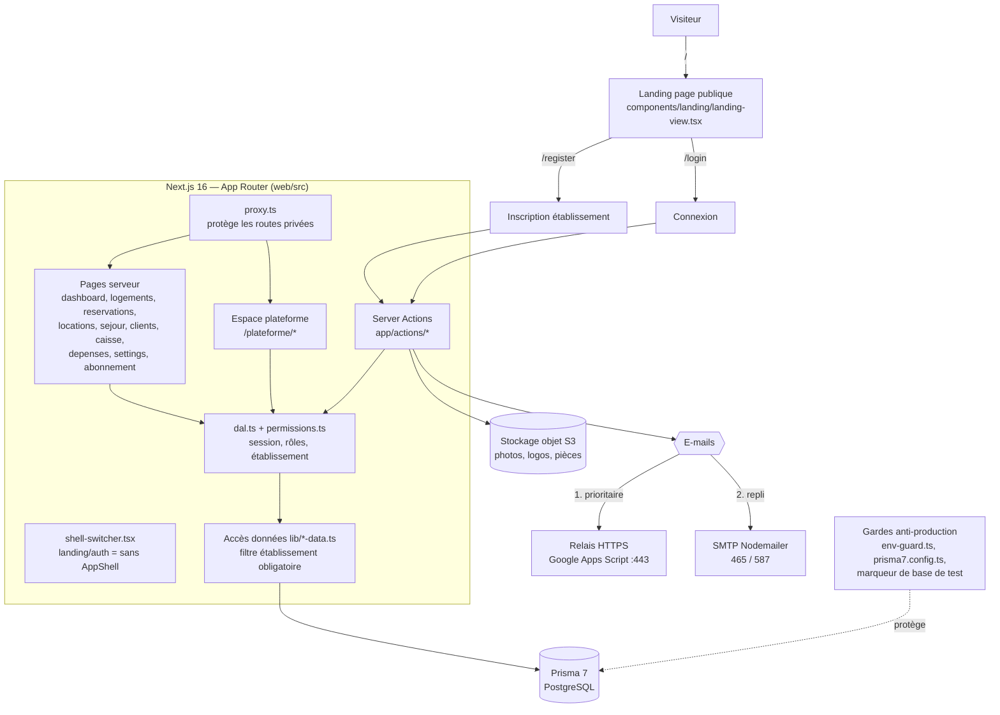
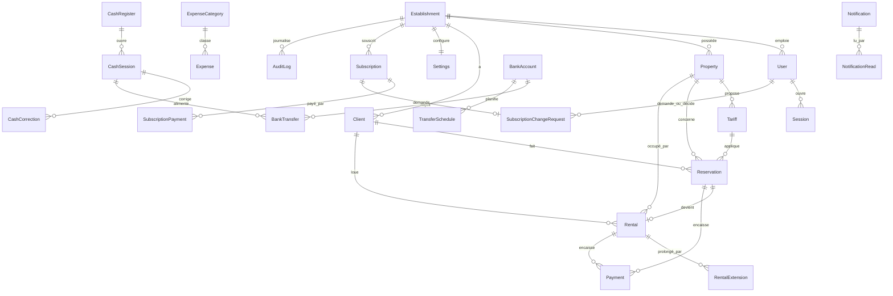

# SAMA HOME — Présentation du projet (vue d'ensemble pour un nouvel agent)

> Document de présentation : à lire **avant** `AGENTS.md` (règles) et `AGENT_HANDOFF.md` (état courant, opérations interdites, risques). Il décrit ce qui existe ; il ne remplace ni l'un ni l'autre.
> Dernière mise à jour : 2026-10-25. Faits relevés dans le dépôt à cette date (branche `work/sama-home-preparation`, HEAD `33604ca`). Aucun test ni build n'a été exécuté pour rédiger ce document.

---

## 1. Le produit en bref

**SAMA HOME** est un SaaS multi-établissements (multi-tenant) pour les résidences meublées, hôtels, auberges, maisons d'hôtes et appartements au Sénégal. Interface en français, montants en FCFA. Éditeur : COMPAGNIE GUEYE TAWFEKH (C.G.T).

Deux populations d'utilisateurs, strictement séparées :

| Population | Marqueur en base | Garde (`src/lib/dal.ts`) | Espace |
|---|---|---|---|
| Équipe d'un établissement (admin, réceptionniste…) | `role` + `establishmentId` | `requireAdmin()` | `/dashboard`, `/logements`, `/reservations`… |
| Équipe SAMA HOME (plateforme) | `isPlatformAdmin = true` (+ `permissions`) | `requirePlatformAdmin()` | `/plateforme/*` |

---

## 2. Schéma d'architecture



Version texte (si Mermaid n'est pas rendu) :

```
Visiteur ─► Landing (/) ─► /register, /login
                              │
                      proxy.ts (routes privées)
                              │
        Pages serveur ─► Server Actions ─► dal.ts / permissions.ts
                                              │
                                  lib/*-data.ts (filtre establishmentId)
                                              │
                              Prisma 7 ─► PostgreSQL
        Server Actions ─► S3 (fichiers)   ─► E-mails : relais HTTPS puis SMTP
        Gardes (env-guard, marqueur de base de test) protègent la base
```

Règle d'or : l'`establishmentId` vient **toujours** de la session serveur, jamais du navigateur ; chaque requête métier filtre par établissement.

---

## 3. Schéma de la base de données (vue simplifiée)

46 déclarations dans `web/prisma/schema.prisma` (modèles et énumérations), 27 migrations. Relations principales :



Modèles hors schéma ci-dessus : `PlatformSettings` (singleton de réglages plateforme), `PricingSettings` (tarification des abonnements), `OtpVerification` et `PasswordResetToken` (mot de passe oublié). Les clés étrangères métier sont en `Restrict` ; les suppressions passent par des transactions ordonnées (voir `AGENTS.md` §6.6) et par `src/lib/user-purge.ts`.

---

## 4. La nouvelle landing page

**Où** : route `/` (`web/src/app/page.tsx`) qui rend `web/src/components/landing/landing-view.tsx` (≈ 1 380 lignes, composant unique). Métadonnées SEO définies dans `page.tsx`. Une route `src/app/landing/` existe aussi.

**Principe** : page publique **isolée**. Elle n'est jamais enveloppée par l'`AppShell`, même avec une session valide (correctif du « double en-tête », `shell-switcher.tsx`, `AGENTS.md` §6.3). Thème sombre « luxe », palette orange/ambre de la charte SAMA HOME (le vert a été supprimé).

**Sections (ancres)** :

| Ancre | Contenu |
|---|---|
| en-tête | Logo officiel, menu avec sous-menus déroulants, boutons « Se connecter » / « Créer un établissement », menu mobile |
| `#presentation` | Héros : titre, appels à l'action (connexion, démonstration WhatsApp) |
| `#multi-ecrans` | Maquettes PC / tablette / téléphone avec les **vraies captures de l'application** et sélecteur interactif |
| `#residences` | Vitrine de résidences (photos de suites et chambres) |
| `#tarifs` | Bandeau de 4 chiffres clés (isolation multi-tenant, rapprochement de caisse, contrat en 1 clic, temps réel) |
| `#fonctionnalites` | « Sans / Avec SAMA HOME » |
| `#modules` | Les modules de l'application |
| `#contact` | Pied de page : liens (connexion, inscription, mot de passe oublié, ancres), mentions légales de l'éditeur |
| bouton flottant | « Accéder à l'application » (desktop) / « Accéder à l'app » (mobile) vers `/login`, `fixed bottom-5 right-4 sm:bottom-6 sm:right-6` |

**Ressources** : `web/public/images/landing/` (maquettes `mockup-*`, photos de résidences), `web/public/images/screenshots/`, `web/public/brand/` (logos : orange, bleu nuit, blanc cassé, transparent, icônes). Les images publiques sont exclues du proxy (`images/`, `brand/` dans le matcher, `AGENTS.md` §6.4).

**Responsive** : textes centrés sur mobile/tablette, `overflow-x-hidden` à la racine, mise en page testée mobile/tablette (commits `3e3dcd6`, `ebb87b6`, `4e458fc`).

**Supports marketing associés** : `web/public/affiches.html` (studio d'export des affiches), 5 affiches HD (carré 1080×1080 et story 1080×1920), `CATALOGUE_ET_GUIDE_UTILISATEUR.md`.

Historique : `b86310e` → `fb54032` → `6c15428` (version « fintech luxe ») → `664a6dc` (maquettes multi-écrans) → `218a7ac` (vraies captures) → `4e458fc` / `6ca21c2` (finitions, sous-menus, bouton flottant).

---

## 5. Chronologie des grandes modifications (depuis 2026-10-18)

| Date | Thème | Détail (commits principaux) |
|---|---|---|
| 18/10 | Interface | Menu haut fixe avec sous-menus, logo officiel partout, tableau de bord enrichi (cartes de chambres, minuteurs, décompte de sortie), formulaires date/heure sombres, optimisations mobile (`c3cb710`, `99716bd`, `859d172`) |
| 18-19/10 | Métier | Location « par heure / par jour », contrat de bail PDF officiel, partage WhatsApp personnalisable, création rapide de client, seuil CNI, suppression de logement, édition/suppression de tarifs (`9f30c38`, `c8f973c`, `0191b6c`, `cdfdce9`) |
| 19/10 | Sécurité | Permissions granulaires plateforme/établissement, anti-escalade de privilèges, durcissement des Server Actions, mot de passe oublié par OTP e-mail, purge complète des comptes supprimés, audit sécurité global (`59f348b`, `e6d76aa`, `fc07e5c`, `442fa1b`, `8348279`) |
| 19/10 | E-mails | Relais HTTPS prioritaire + repli SMTP multi-ports (`a3b3bf9`, `95aefbb`, `bd61544`) |
| 19/10 | Caisse | Interconnexion caisse ↔ dépenses, badge « machine connectée », remplacement des emojis par des icônes (`3a35125`) |
| 19/10 | Landing + marketing | Voir section 4 ; catalogue utilisateur ; règles globales (`AGENTS.md`) et guide architectural |
| 19/10 | Production | Page 404 de marque, journalisation `backup-db` (`f6c4df7`) |
| 19-20/10 | Branding | 5 affiches publicitaires HD avec l'interface réelle (`dd5aefa` → `88730a6`) |
| 20/10 | Sécurité / audit | Retrait des secrets codés en dur dans `mail.ts` ; rapport d'audit final (`a28e7a5`, `ef069d6`) |
| 24/10 | Isolation | Gardes locales contre la production, scripts historiques neutralisés, documentation d'exploitation alignée (`4563fa0`, `128a3da`, `33604ca`) |
| en cours (non commité) | Lot 3B | Demandes de changement d'abonnement : modèle `SubscriptionChangeRequest`, migration `20261023120000`, décision côté plateforme, tests dédiés |
| en cours (non commité) | Durcissement | OTP, sessions (`session-policy.ts`, `otp.ts`), filtres de réservations, paiement du plan à l'approbation, tarification par défaut (`pricing-defaults.ts`), boîte de confirmation (`ui/confirm-dialog.tsx`), tests associés |

Au total, 128 commits dans l'historique à la date de ce document. Les éléments « non commités » sont dans la copie de travail : ne jamais les perdre (`AGENT_HANDOFF.md` §5).

---

## 6. Où trouver quoi

| Besoin | Fichier |
|---|---|
| Règles de développement et de sécurité | `AGENTS.md` |
| État courant, risques, interdits, journal | `AGENT_HANDOFF.md` |
| Lancer le projet, scripts npm | `web/README.md` |
| Déploiement, sauvegarde, restauration, incidents | `web/docs/production/` |
| Isolation du développement local | `web/docs/production/LOCAL_DEV_ISOLATION.md` |
| Patterns réutilisables et pièges rencontrés | `GUIDE_ARCHITECTURAL_ET_PATTERNS_REUTILISABLES.md` |
| Audits (historiques, non rejoués) | `RAPPORT_AUDIT_FINAL.md`, `RAPPORT_AUDIT_ET_ANALYSE_SAMA_HOME.md` |
| Description commerciale et guide utilisateur | `CATALOGUE_ET_GUIDE_UTILISATEUR.md` |
| Décisions et améliorations envisagées | `améliorations.md` (registre ; une décision n'est pas une fonctionnalité livrée) |

---

## 7. Consignes minimales pour le nouvel agent

1. Ne jamais lire ni afficher les fichiers `.env*` ni aucun secret.
2. Aucune opération sur une base de données, aucun test, build, commit ou push sans autorisation explicite ; ne jamais pousser vers le dépôt public `origin`.
3. Ne rien supprimer ni écraser dans la copie de travail (pas de `checkout`, `reset`, `restore`, `clean`, `stash`).
4. Distinguer ce qui est constaté, proposé et non vérifié ; une vérification statique n'est pas un test exécuté.
5. Terminer toute tâche en mettant à jour `AGENT_HANDOFF.md`.
