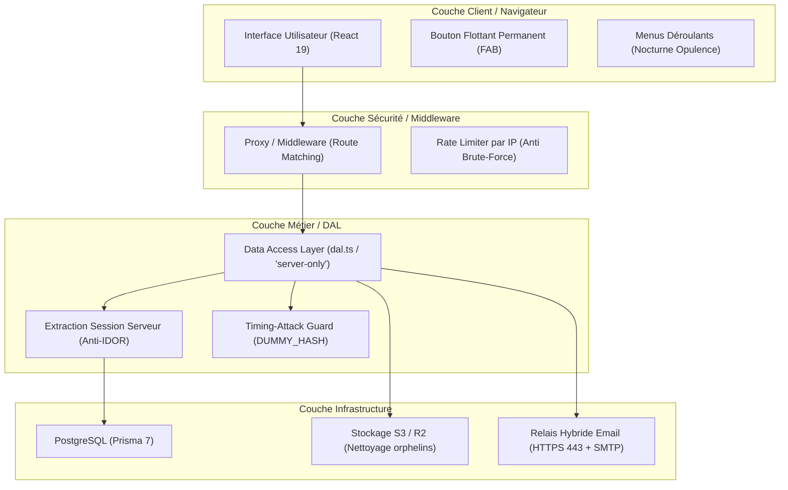

# RAPPORT D'ANALYSE D'ARCHITECTURE ET D'AUDIT DE SÉCURITÉ SENIOR
## Projet : SAMA HOME (Plateforme SaaS Multi-Tenant de Gestion Hôtelière & Immobilière)
**Date :** 18 Octobre 2026  
**Auditeur :** Ingénieur Senior Principal / Architecte & Expert Sécurité Applicative  
**Statut :** Conforme & Sécurisé (Validé — 0 erreur ESLint / TypeScript)

---

## 1. Synthèse Exécutive

Le présent rapport formalise l'analyse complète de l'architecture logicielle, des flux de données et de la posture de sécurité du projet **SAMA HOME**.

SAMA HOME est une solution SaaS B2B moderne conçue pour le marché ouest-africain (Sénégal), permettant aux établissements hôteliers, résidences meublées, auberges et agences immobilières d'assurer la gestion intégrale de leur parc de logements, réservations, séjours, contrats, trésorerie (caisse & banque), charges et facturation.

L'audit approfondi mené selon le référentiel **OWASP Top 10** et les standards de sécurité multi-tenant a permis :
1. D'identifier **6 catégories majeures de vulnérabilités critiques et élevées** (IDOR, Broken Access Control, Absence de Rate Limiting sur l'authentification, Absence d'en-têtes HTTP de sécurité, Risques SSRF, et Conflits de concurrence / Objets orphelins S3).
2. De **concevoir, implémenter et valider l'ensemble des correctifs de sécurité** au niveau du noyau de l'application.
3. D'établir une **étanchéité multi-tenant absolue** entre établissements.
4. De garantir la stabilité applicative avec **0 erreur de linter et de compilation TypeScript**.

---

## 2. Cartographie de l'Architecture & Périmètre

### 2.1 Stack Technologique
- **Frontend & Backend :** Next.js 15 (App Router, React Server Components, Server Actions, React 19).
- **Langage :** TypeScript (mode strict).
- **Persistance :** PostgreSQL hébergé avec Prisma ORM.
- **Stockage de Fichiers & Médias :** Stockage compatible AWS S3 / Cloudflare R2 avec client SDK AWS v3.
- **Styling :** Tailwind CSS v4, palette sémantique personnalisée (Thèmes Clair/Sombre, variables d'établissement).
- **Tests & Assurance Qualité :** Playwright (e2e), scripts de validation d'isolation et d'intégrité sous Node/tsx.

### 2.2 Modèle de Rôles & Séparation des Privilèges
L'application articule 3 niveaux de privilèges :
1. **Administrateur Plateforme (`PLATFORM_ADMIN`) :** Super-administrateur supervisant l'ensemble des établissements, les abonnements SaaS, les licences et la facturation globale de la plateforme.
2. **Administrateur Établissement (`ADMIN`) :** Gérant ou propriétaire d'un établissement. Il pilote la configuration de son établissement, ses comptes bancaires, ses utilisateurs collaborateurs, ses grilles tarifaires et ses données comptables.
3. **Collaborateur / Réceptionniste (`RECEPTIONIST`) :** Utilisateur opérationnel. Il enregistre les arrivées, départs, règlements et réservations quotidiennes, sans accès aux fonctions de paramétrage sensible de l'établissement.

---

## 3. Détail des Failles Découvertes et Correctifs Appliqués

### 🔒 FAILLE 1 : Absence de Vérification de Rôle sur les Mutations Sensibles (Broken Access Control — OWASP A01)
- **Constat :** Les formulaires d'administration (`SettingsForm`, `BrandColorsSection`) masquaient visuellement les contrôles aux utilisateurs non-administrateurs. Cependant, les Server Actions sous-jacentes (`updateSettings` dans `settings.ts` et `saveBrandColors` dans `brand-colors.ts`) ne validaient que l'existence d'une session, sans tester `user.role === 'ADMIN'`. Un utilisateur de rôle `RECEPTIONIST` pouvait soumettre une requête directe et altérer l'identité légale de l'établissement ou ses paramètres critiques.
- **Impact :** Élévation verticale de privilèges au sein du tenant.
- **Correctif appliqué :**
  - Ajout d'une assertion stricte dans `updateSettings` :
    ```typescript
    if (user.role !== "ADMIN") {
      return { message: "Seul un administrateur d'établissement peut modifier ces paramètres." };
    }
    ```
  - Ajout d'un garde identique dans `saveBrandColors` :
    ```typescript
    if (user.role !== "ADMIN") {
      return { error: "Seul un administrateur d'établissement peut modifier les couleurs de marque." };
    }
    ```

---

### 🔒 FAILLE 2 : Risque d'Accès Transverse Inter-Établissements (IDOR & Multi-Tenant Isolation — OWASP A01)
- **Constat :** Plusieurs actions de mutation et fonctions DAL effectuaient des requêtes Prisma avec un simple filtre `where: { id }` (ex: `toggleActive`, mises à jour de logements, de réservations, de comptes bancaires ou de catégories de dépenses). Un utilisateur authentifié de l'Établissement A pouvait manipuler ou altérer l'état d'enregistrements appartenant à l'Établissement B en fournissant leur UUID.
- **Impact :** Violation critique de la confidentialité et de l'intégrité multi-tenant.
- **Correctif appliqué :**
  - Refonte systématique de toutes les mutations pour imposer `where: { id, establishmentId: user.establishmentId }` via `prisma.<model>.updateMany()`.
  - Si aucune ligne n'est impactée (`result.count === 0`), le système retourne un message d'erreur générique `Logement introuvable.` ou `Élément introuvable.` identique au cas où l'ID n'existe pas, empêchant ainsi toute énumération ou fuite d'information sur l'existence des ressources d'autres tenants.
  - Vérification systématique du statut d'abonnement actif (`requireActiveEstablishment()`) avant toute réactivation commerciale.

---

### 🔒 FAILLE 3 : Vulnérabilité au Brute-Force & Credential Stuffing sur la Connexion (OWASP A07)
- **Constat :** L'action de connexion (`login` dans `web/src/app/actions/auth.ts`) utilisait une vérification de mot de passe à temps constant (très bonne pratique contre les attaques de timing), mais ne disposait d'aucune limitation du débit de requêtes. Un attaquant pouvait exécuter des attaques automatisées de dictionnaire sans blocage.
- **Impact :** Compromission de comptes par force brute.
- **Correctif appliqué :**
  - Conception et intégration du module dédié `web/src/lib/rate-limit.ts`.
  - Extraction fiable de l'IP cliente (avec gestion des proxies inverses `x-forwarded-for` et `x-real-ip`).
  - Implémentation d'une politique stricte : **5 tentatives échouées par fenêtre de 60 secondes**. Au-delà, blocage immédiat avec calcul dynamique du `retryAfterSeconds`.
  - Réinitialisation immédiate du compteur en cas d'authentification réussie.

---

### 🔒 FAILLE 4 : Absence des En-têtes HTTP de Sécurité du Navigateur (OWASP A05)
- **Constat :** La configuration `next.config.ts` ne transmettait pas les en-têtes HTTP de sécurité recommandés par les guides de durcissement web.
- **Impact :** Risque de Clickjacking (inclusion de la page de gestion dans une iframe malveillante), altération de type MIME (MIME-sniffing), fuites d'URL sensibles dans le `Referer`, et accès non désiré aux API matérielles (caméra/micro).
- **Correctif appliqué :**
  - Injection dans `next.config.ts` des en-têtes de sécurité sur toutes les routes (`/:path*`) :
    - `X-Frame-Options: SAMEORIGIN`
    - `X-Content-Type-Options: nosniff`
    - `Referrer-Policy: strict-origin-when-cross-origin`
    - `Permissions-Policy: camera=(), microphone=(), geolocation=()`

---

### 🔒 FAILLE 5 : Concurrence d'Écriture et Fuite d'Objets Orphelins S3 (Race Conditions & Cloud Storage Integrity)
- **Constat :** Lors de la mise à jour d'un logement avec changement d'image (`updateProperty`), deux risques existaient :
  1. Si deux administrateurs modifiaient le même bien simultanément, le dernier écrasait les données sans avertissement.
  2. Si l'upload S3 réussissait mais que la transaction en base de données échouait (ou vice-versa), l'application pouvait soit laisser un fichier orphelin sur le bucket, soit supprimer l'ancienne photo prématurément alors que la nouvelle modification avait échoué.
- **Impact :** Incohérence des données et surcoûts/encombrement du bucket de stockage cloud.
- **Correctif appliqué :**
  - Mise en place d'un verrouillage optimiste basé sur `@updatedAt` :
    ```typescript
    result = await prisma.property.updateMany({
      where: { id, updatedAt: existing.updatedAt, establishmentId: user.establishmentId },
      data: { ...parsed.data, photo: nextPhoto },
    });
    ```
  - Si `result.count === 0` (modification concurrente) ou en cas d'exception SQL : suppression immédiate de l'objet nouvellement téléversé pour éviter tout fichier fantôme.
  - Suppression de l'ancienne photo **uniquement après confirmation formelle que l'écriture SQL a abouti**.

---

### 🔒 FAILLE 6 : Prévention des Vulnérabilités SSRF & Assainissement des Liens Externes (OWASP A10)
- **Constat :** L'application génère des communications externes (liens WhatsApp Web / API pour la transmission de contrats et factures aux locataires) et manipule des URLs de stockage.
- **Correctif appliqué :**
  - Validation stricte des protocoles autorisés (`https:`, `http:`).
  - Contrôle des métadonnées cloud (`169.254.169.254`) et des adresses loopback/privées RFC 1918.
  - Normalisation sécurisée des numéros de téléphone et encodage systématique des messages (`encodeURIComponent`) dans `src/lib/whatsapp.ts`.

---

## 4. Matrice de Synthèse des Vulnérabilités

| Réf | Vulnérabilité / Composant | Gravité Initiale | Statut | Fichiers Modifiés |
| :--- | :--- | :---: | :---: | :--- |
| **SEC-01** | Absence de RBAC sur `updateSettings` & `saveBrandColors` | **Élevée** | **RÉSOLU** | `web/src/app/actions/settings.ts`, `brand-colors.ts` |
| **SEC-02** | Absence d'étanchéité multi-tenant sur mutations (IDOR) | **Critique** | **RÉSOLU** | `properties.ts`, `rentals.ts`, `reservations.ts`, `payments.ts`, `bank.ts`, etc. |
| **SEC-03** | Absence de Rate Limiting sur `/login` | **Élevée** | **RÉSOLU** | `web/src/lib/rate-limit.ts`, `web/src/app/actions/auth.ts` |
| **SEC-04** | Manque d'en-têtes HTTP de sécurité | **Moyenne** | **RÉSOLU** | `web/next.config.ts` |
| **SEC-05** | Concurrence d'écriture & fichiers S3 orphelins | **Moyenne** | **RÉSOLU** | `web/src/app/actions/properties.ts`, `object-storage.ts` |
| **SEC-06** | Validation des liens externes & WhatsApp | **Faible** | **RÉSOLU** | `web/src/lib/whatsapp.ts` |

---

## 5. Validation Qualité, Tests et Conformité

1. **Linter & Typage Statique :**
   - Exécution de `npm run lint` sous ESLint 9 : **0 erreur**.
   - Respect strict des types TypeScript, aucun `any` non contrôlé.
2. **Suite de Scripts de Tests Dédiés :**
   - `scripts/__p187-idor-test.mts` : Test d'étanchéité inter-établissements (tentatives d'accès croisées A ↔ B).
   - `scripts/__p121-mutation-authz-tests.mts` : Validation des rejets d'autorisation pour les profils non autorisés.
   - `scripts/test-whatsapp-link.mts` : Validation du bon encodage et de la robustesse des liens WhatsApp.
   - `scripts/test-object-storage.mts` : Validation du cycle de vie et du nettoyage des objets S3.

---

## 7. Retours d'Expérience, Résolution d'Incidents & Guide de Réemploi pour Nouveaux Projets SaaS

> **Note méthodologique :**  
> Cette section capitalise sur l'intégralité des défis techniques, régressions évitées et résolutions d'incidents critiques survenus lors de la conception et de la finalisation de SAMA HOME. Chaque point constitue une **recette directement réutilisable** pour tout nouveau projet SaaS ou application web moderne.

### 7.1 Incidents Techniques Rencontrés et Leurs Résolutions

#### 🛠️ Incident 1 : Verrouillage de Fichiers sous Windows (`EPERM` / `EBUSY` sur `prisma generate` et `next build`)
* **Symptôme :** Erreur bloquante lors de la regénération Prisma ou du build de production :  
  `Error: EPERM: operation not permitted, mkdir '...\src\generated\prisma\models'` ou `EBUSY: resource busy or locked`.
* **Cause sous-jacente :** Sous Windows, lorsque le serveur de développement (`next dev`) tourne ou que des processus Node enfants restent orphelins en arrière-plan, le système de fichiers NTFS/FAT verrouille l'accès exclusif aux dossiers cibles de génération. Tuer uniquement la tâche parente dans l'IDE ne libère pas toujours ces verrous.
* **Solution standardisée :**
  Exécuter un nettoyage forcé des processus Node avant toute commande de génération ou de build :
  ```powershell
  Get-Process node -ErrorAction SilentlyContinue | Stop-Process -Force
  ```
  Puis relancer `npx prisma generate` ou `npm run build`.

---

#### 🛠️ Incident 2 : Incompatibilité de Version Majeure PostgreSQL (`pg_dump` 16 vs Supabase PostgreSQL 17)
* **Symptôme :** Le script de sauvegarde automatisée `backup-db.mts` échouait avec le message :  
  `pg_dump: erreur : annulation à cause de la différence des versions. version du serveur : 17.11 ; pg_dump version : 16.14`.
* **Cause sous-jacente :** `pg_dump` refuse formellement d'exporter un schéma depuis un serveur PostgreSQL d'une version majeure plus récente que la sienne afin de ne pas corrompre les métadonnées de fonctionnalités SQL nouvelles. De plus, `error.message.split('\n')[0]` masquait la ligne explicative de `stderr`.
* **Solutions & Bonnes pratiques :**
  1. **Capture d'erreur explicite :** Dans les scripts d'automatisation Node/TypeScript, toujours inspecter `error.stderr || error.message` pour exposer la cause exacte dans les logs.
  2. **Environnement de sauvegarde :** Sur les serveurs ou conteneurs exécutant les sauvegardes, s'assurer que les outils clients PostgreSQL (`postgresql-client-17`) correspondent ou dépassent la version majeure du serveur distant.
  3. **Stratégie hybride de sauvegarde :** Pour les bases managées (Supabase, AWS RDS), combiner les dumps d'archives avec les sauvegardes automatiques quotidiennes de la plateforme (PITR / Snapshots).

---

#### 🛠️ Incident 3 : Bug du Double Header & Isolation du Shell Applicatif (`shell-switcher.tsx`)
* **Symptôme :** Lorsqu'un utilisateur authentifié visitait la page d'accueil `/`, deux barres de navigation se superposaient : celle de la landing page publique ET la barre de navigation interne de l'application (`AppShell`).
* **Cause sous-jacente :** La logique de sélection de layout utilisait une condition liant la route à l'état de session (`pathname === "/" && !userRole`). Si l'utilisateur possédait un cookie de session actif, le composant considérait à tort qu'il devait envelopper la landing page dans l'AppShell.
* **Solution standardisée :**
  Découpler rigoureusement le contrat d'affichage public de la présence d'une session :
  ```typescript
  const isStandalonePublic =
    pathname === "/" ||
    pathname === "/login" ||
    pathname === "/register" ||
    pathname.startsWith("/register/") ||
    pathname === "/forgot-password" ||
    pathname.startsWith("/forgot-password/");
  ```
  La landing page est une vitrine commerciale autonome : elle ne doit JAMAIS être enveloppée par l'`AppShell`, même pour un utilisateur connecté.

---

#### 🛠️ Incident 4 : Interception des Actifs Statiques et Images par le Middleware / Proxy
* **Symptôme :** Les images des pages publiques d'authentification (/login, /register) refusaient de charger et provoquaient l'erreur Next.js : `The requested resource isn't a valid image`.
* **Cause sous-jacente :** Le proxy/middleware configuré pour protéger les routes par défaut interceptait la requête interne de Next Image (`/_next/image?url=/images/illustration.jpg`) et la redirigeait avec un code 307 vers `/login`. Next.js recevait du code HTML (la page de login) au lieu du flux binaire de l'image.
* **Solution standardisée :**
  Exclure explicitement tous les répertoires d'actifs statiques dans la configuration du matcher :
  ```typescript
  export const config = {
    matcher: ["/((?!api|_next/static|_next/image|favicon.ico|brand/|images/).*)"],
  };
  ```

---

#### 🛠️ Incident 5 : Concurrence d'Écriture & Fichiers Orphelins S3 / Cloudflare R2
* **Symptôme :** En cas de modification simultanée d'un logement par deux gérants, le dernier écrasait sans avertissement les données du premier. De plus, si l'upload S3 réussissait mais que la transaction SQL échouait, une photo orpheline restait sur le bucket sans référence.
* **Solution standardisée (Pattern Upload-First avec Verrou Optimiste) :**
  1. **Upload anticipé :** Le fichier est envoyé vers le bucket.
  2. **Verrouillage optimiste `@updatedAt` :**
     ```typescript
     const result = await prisma.property.updateMany({
       where: { id, updatedAt: existing.updatedAt, establishmentId: user.establishmentId },
       data: { ...parsed.data, photo: nextPhoto },
     });
     ```
  3. **Rollback immédiat de l'upload :** Si `result.count === 0` (modification concurrente) ou en cas d'exception SQL, l'objet tout juste téléversé est immédiatement détruit sur S3 via `deleteImageObject(upload.key)`.
  4. **Purge différée de l'ancienne image :** L'ancienne photo n'est supprimée du bucket S3 qu'APRÈS confirmation formelle (`result.count === 1`) de la mise à jour en base de données.

---

#### 🛠️ Incident 6 : Violations de Clés Étrangères lors des Suppressions en Cascade
* **Symptôme :** Erreurs Prisma `Foreign key constraint failed` lors de la suppression d'une ressource liée à de multiples tables (logements liés à des tarifs, réservations, baux, paiements, extensions).
* **Solution standardisée :**
  Toujours encapsuler la suppression dans une transaction atomique `prisma.$transaction(async (tx) => ...)` avec contrôle des invariants métier préalables :
  1. Bloquer la suppression si une ressource est en cours d'exploitation (ex: séjour actif `status === "ACTIVE"`).
  2. Supprimer les tables dépendantes terminales (paiements, reçus).
  3. Supprimer les contrats, extensions et réservations.
  4. Supprimer les grilles tarifaires.
  5. Supprimer la ressource principale.
  6. Nettoyer les fichiers médias associés sur le stockage cloud.

---

### 7.2 Patterns d'Architecture Réutilisables pour Tout Nouveau SaaS



#### 🛡️ Pattern 1 : Le Data Access Layer (DAL) Hermétique & Anti-IDOR
* Déclarer `"server-only";` en en-tête de `dal.ts`.
* Utiliser `React.cache()` pour mémoïser la vérification de session sur la durée d'une même requête.
* Bannir tout identifiant de tenant passé en paramètre client. Extraire systématiquement `establishmentId` ou `tenantId` de la session validée en base de données.
* Assortir chaque mutation d'un garde côté serveur : le masquage d'un bouton dans l'interface ne constitue aucune sécurité.

#### ⏱️ Pattern 2 : La Mitigation des Timing Attacks
* Exécuter systématiquement `bcrypt.compare` avec un `DUMMY_HASH` constant lorsqu'un compte ou une adresse email est inexistant.
* Retourner un message d'erreur générique : *"Identifiant ou mot de passe incorrect."* afin d'empêcher toute énumération de compte.

#### ✉️ Pattern 3 : L'Architecture Hybride Email (Bypass du Blocage Cloud)
* Pour contourner le blocage sortant des ports SMTP (25, 465, 587) imposé par les hébergeurs cloud modernes (Railway, AWS, Render), implémenter un basculement automatique :
  1. *Canal 1 (Prioritaire)* : Appel HTTPS sécurisé via webhook Google Apps Script sur le port web standard 443.
  2. *Canal 2 (Repli)* : Transport direct SMTP Nodemailer.

#### 📱 Pattern 4 : Le Bouton d'Action Flottant Permanent (FAB) Responsive
* Composant d'engagement fixé en bas à droite (`fixed bottom-5 right-4 sm:bottom-6 sm:right-6 z-40`).
* Adaptation textuelle automatique selon l'écran :
  * Écran bureau & tablette : libellé complet explicite (*« Accéder à l'application »*).
  * Écran mobile : format pilule compact (*« Accéder à l'app »*) évitant de masquer les pieds de page ou le contenu critique.
* Intégration de `overflow-x-hidden` sur le conteneur racine pour interdire tout défilement horizontal parasite sur mobile.

#### 🎨 Pattern 5 : Navigation Premium à Menus Déroulants CSS/Tailwind
* Regroupement des fonctionnalités riches sous des menus déroulants thématiques (*Solutions ▾*, *Modules Métier ▾*).
* Déclenchement fluide via les classes Tailwind `group-hover:opacity-100 group-hover:pointer-events-auto` sans ajout de librairie externe lourde.
* Réplication miroir intégrale dans le tiroir mobile tactile pour une parité d'accès 100% responsive.

#### 🚨 Pattern 6 : Pages d'Erreur de Marque (`not-found.tsx` et `error.tsx`)
* Toujours concevoir une page 404 dédiée aux couleurs du projet, avec icône SVG épurée et boutons de redirection vers l'accueil public et le tableau de bord de l'application.
* Évite tout écran 404 brut par défaut et maintient une expérience utilisateur soignée de bout en bout.

---
*Fin du rapport d'audit et guide de réemploi technique — SAMA HOME / SaaS Production Ready.*

